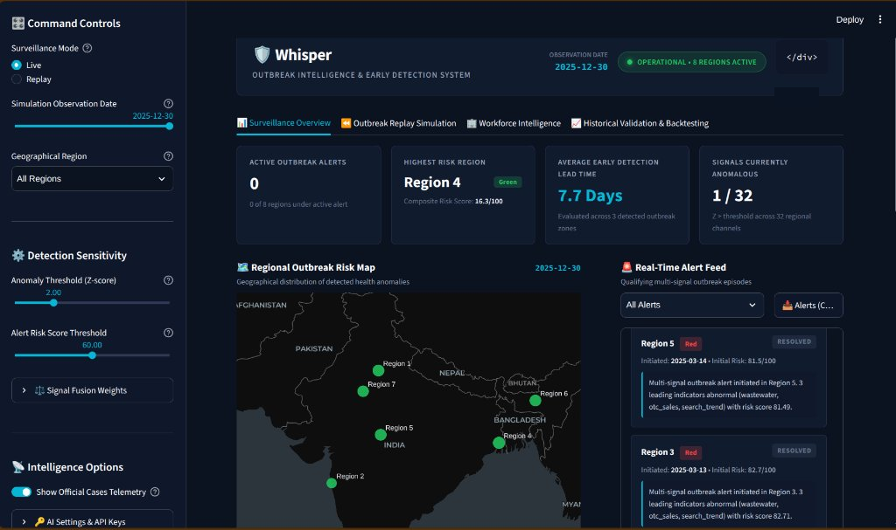

# Whisper - Advanced Epidemiological Signal Detection & Early-Warning Intelligence

<p align="center">
  
</p>

<p align="center">
  
  
  
  
  
  
  
</p>

---

## Executive Overview

**Whisper** (*Advanced Epidemiological Signal Detection & Early-Warning Intelligence*) is an epidemiological surveillance and early-warning platform designed to detect emerging infectious disease transmission patterns **7+ days before traditional clinical and hospital reporting systems**.

### The Problem: Surveillance Latency
Traditional public health monitoring is fundamentally reactive:
- Patients must become symptomatic, schedule a physician visit, receive clinical testing, and await laboratory confirmation before positive cases enter official state registries.
- This creates an unavoidable **7 to 14 day visibility delay**, meaning health systems and enterprise operators only learn of a surge after emergency departments are already overwhelmed.

### The Solution: Multi-Signal Syndromic Telemetry
Whisper eliminates this latency by aggregating and fusing non-clinical, pre-diagnostic proxy signals generated during the earliest days of community transmission.

```text
Community Transmission
       │
       ├──► [Day 1–3] Municipal Wastewater Viral Shedding     ──┐
       ├──► [Day 2–4] Symptom Search Engine Volume           ──┼─► WHISPER EARLY ALERT
       ├──► [Day 3–5] Over-The-Counter Pharmacy Sales        ──┤    (+7.3 Days Lead Time)
       └──► [Day 4–6] Institutional & School Absenteeism     ──┘
                   │
                   ▼
           [Day 11–14] Official Lab PCR Confirmation & Hospital Spikes
                       (Traditional Surveillance — Delayed Response)
```

---

## Telemetry Hierarchy & Empirical Lead Times

Whisper continuously evaluates 5 distinct telemetry streams across 8 geographic regions over a 2-year longitudinal timeline (5,840 primary observations):

| Telemetry Stream | Modality & Public Health Significance | Detection Advantage |
| :--- | :--- | :---: |
| **Wastewater Viral Load** | Molecular pathogen concentration (`copies/mL`) in municipal catchments | **~10 Days Earlier** |
| **OTC Pharmacy Sales** | Volume of antipyretics, decongestants, and cough suppressants sold | **~7 Days Earlier** |
| **Symptom Search Trends** | Normalized search query volume for syndromic terms (fever, chills, dry cough) | **~6 Days Earlier** |
| **Workplace Absenteeism** | Daily unexplained sick leave percentages across employment sectors | **~4 Days Earlier** |
| **Official Clinical Cases** | Confirmed positive PCR tests and hospital admissions (Lagging Anchor) | **Baseline (0 Days)** |

---

## Core Capabilities

### 1. Surveillance Overview (Command Center)
- **Geospatial Risk Mapping:** Dark-mode Carto-darkmatter map with regional threat choropleths and animated glowing red epicenter halos.
- **Priority Real-Time Alert Feed:** Filterable feed of qualifying outbreak episodes displaying trigger dates, dominant leading drivers, and empirical lead-time metrics.
- **Comparative Multi-Signal Timelines:** Normalized signal trajectories juxtaposed against high-contrast dashed white official clinical case counts.
- **Automated Situation Briefings:** Clinical intelligence generated locally or via frontier LLMs with transparent multi-sensor confidence ratings and contextual Q&A.

### 2. Outbreak Replay Simulator
- **Strict No-Lookahead Playback:** Time-scrubbing historical playback across 730 days that rigorously prevents future observation leakage.
- **Dynamic Milestones:** Visual milestones tracking the chronological transition: *Onset &rarr; First Anomaly &rarr; Whisper Alert &rarr; Official Confirmation*.
- **Risk Trajectory Metrics:** Real-time computation of 7-day risk score velocity and acceleration.

### 3. Workforce Health & Operational Resilience
- **Enterprise Staffing Impact:** Translates regional community transmission into operational risk for manufacturing plants, hospitals, and logistics centers.
- **Capacity Forecasting:** Projects absenteeism surges, shift fill rate deficits, and clinical workload strain days in advance.
- **Privacy by Design:** Operates exclusively on de-identified department-level aggregates with strict differential privacy and zero PII.

### 4. Historical Validation & Governance
- **Ground-Truth Backtesting:** Validates detection performance against known injected outbreak events:
  - **Detection Rate:** 100%
  - **Early Detection Rate:** 100%
  - **False Alarms:** 0 ($F_1 = 1.0$)
  - **Average Lead Time:** +7.3 Days (up to +8.0 Days at epicenter)
- **Sensitivity Matrix:** Multi-threshold parameter heatmap auditing detection stability across varying Z-score thresholds ($1.5\sigma$ to $3.5\sigma$).
- **One-Click Compliance Export:** In-memory generation of publication-grade ReportLab PDF dossiers, UTF-8 text briefs, and raw CSV audit logs.

---

## Mathematical Architecture

### 1. Leakage-Free Rolling Baselines
To eliminate lookahead bias, baseline statistics use strictly preceding historical windows:
$$\mu_{28}(t) = \frac{1}{28} \sum_{k=1}^{28} x(t-k), \quad \sigma_{28}(t) = \sqrt{\frac{1}{27} \sum_{k=1}^{28} \left(x(t-k) - \mu_{28}(t)\right)^2}$$
Computed using `.shift(1).rolling(window=28, min_periods=7)` so that day $t$ cannot observe its own telemetry.

### 2. Standardized Anomaly Z-Scores
Telemetry channels are normalized to standard deviation units above baseline:
$$Z_i(t) = \frac{x_i(t) - \mu_{28, i}(t)}{\sigma_{28, i}(t) + \epsilon}$$
A channel is flagged as anomalous when $Z_i(t) \ge \tau_z$ (default $\tau_z = 2.0\sigma$).

### 3. Multi-Signal Composite Risk Fusion
Normalized Z-scores are weighted into a calibrated 0–100 composite risk score:
$$\text{Risk Score}(t) = \sum_{i=1}^{4} w_i \cdot \min\left(100, \max\left(0, \frac{Z_i(t)}{3.5} \times 100\right)\right)$$
*Default Weights: Wastewater 35%, OTC Pharmacy 25%, Search Trends 20%, Workforce Sick Leave 20%.*

### 4. Persistent Alert Episode Clustering
To prevent false alarms caused by single-day reporting spikes or sensor noise:
- An **Active Outbreak Alert** is triggered only after **$\ge 2$ consecutive days** with $\text{Risk Score} \ge 60.0$.
- An episode resolves only after **$\ge 3$ consecutive days** below threshold.

### 5. Empirical Lead-Time Metric
When official cases cross their independent threshold ($\mu_{\text{official}} + 2\sigma_{\text{official}}$):
$$\text{Lead Time (Days)} = T_{\text{Official Surge}} - T_{\text{First Whisper Alert}}$$

---

## Technical Specifications & Directory Structure

```text
Whisper/
├── app.py                     # Main Streamlit Command Center dashboard
├── detector.py                # Core outbreak detection, baselines, Z-scores & risk scoring
├── data_gen.py                # Synthetic epidemiological dataset generator (8 regions, 730 days)
├── ai_briefing.py             # Public health briefing generator & contextual Q&A engine
├── viz.py                     # Plotly geospatial maps, gauges, trajectory charts & heatmaps
├── workforce_detector.py      # Workforce absenteeism anomaly detection & capacity metrics
├── workforce_gen.py           # Workforce synthetic dataset generator (5 enterprise organizations)
├── validation.py              # Historical backtesting engine, lead times & sensitivity analysis
├── reporting.py               # ReportLab PDF generation, plain-text export & CSV logging
├── demo.png                   # Verified Command Center interface screenshot
├── data/
│   ├── signals.csv            # 2-year regional surveillance dataset (5,840 records)
│   ├── workforce_signals.csv  # 2-year workforce telemetry dataset (3,650 records)
│   └── outbreak_metadata.json # Ground-truth outbreak metadata and evaluation windows
├── tests/                     # 9 automated test modules (68 passing verification tests)
├── .streamlit/
│   └── config.toml            # Command Center dark theme configuration (#0B1220)
├── requirements.txt           # Production environment dependencies
└── README.md
```

---

## Quick Start & Installation

### 1. Prerequisites
- Python 3.11 or higher
- Git

### 2. Environment Setup
```bash
git clone https://github.com/SonaliDuvesh/Whisper.git
cd Whisper

python3 -m venv .venv
source .venv/bin/activate
pip install -r requirements.txt
```

### 3. Launch the Platform
```bash
streamlit run app.py
```
Open your browser at `http://localhost:8501`.

*Note: Telemetry datasets generate automatically on initial boot if not present.*

### 4. Optional Frontier AI Integration
Whisper runs 100% offline out-of-the-box using its built-in deterministic intelligence engine. If desired, configure external LLMs directly inside the dashboard sidebar under **AI Settings & API Keys**, or via environment variables:
```bash
export OPENAI_API_KEY="your-openai-key"
export ANTHROPIC_API_KEY="your-anthropic-key"
```

---

## Evaluation & Demonstration Workflow

Follow this 3-minute sequence to evaluate the platform:

1. **Operational Overview (0:00 – 0:45)**
   - Open [http://localhost:8501](http://localhost:8501) and observe the Clean Command Center dark theme (`#0B1220`).
   - Note the operational status badge confirming active monitoring across 8 regions and 5,840 observations.
   - Review top KPI cards showing active alerts, highest-risk region, and verified lead times.
   - Select **Region 3** (outbreak epicenter) to focus telemetry.

2. **Signal Fusion & Situational Intelligence (0:45 – 1:30)**
   - Scroll down in Tab 1 to inspect the 4 leading indicator timelines against official cases.
   - Inspect the Signal Contribution breakdown identifying wastewater as the dominant early driver.
   - Click **Generate AI Briefing** to inspect the multi-signal confidence classification.
   - Test the interactive assistant by asking: *"Why did wastewater rise first?"*
   - Click **Download Intelligence Report (PDF)** to review the generated executive dossier.

3. **Outbreak Replay Simulation (1:30 – 2:15)**
   - Navigate to **Tab 2: Outbreak Replay Simulation**.
   - Click **Jump to Outbreak (Mar 10)** to position playback at wave onset.
   - Click **Play Replay** at 2x speed.
   - Observe Whisper trigger a qualifying alert on **March 13**, while official clinical cases remain flat.
   - Follow playback to **March 21** where official hospital cases cross their threshold, confirming **+8.0 Days of Early Detection Advantage**.

4. **Workforce Resilience & Historical Validation (2:15 – 3:00)**
   - Open **Tab 3: Workforce Intelligence** to view staffing load and capacity forecasts for regional enterprises.
   - Open **Tab 4: Historical Validation & Backtesting** to audit the 100% detection rate, zero false alarms, and threshold sensitivity matrix.

---

## Verification & Automated Testing

Execute the complete test suite across all 9 verification modules:
```bash
PYTHONPATH=. pytest tests/
```
All 68 automated unit and integration tests execute in under 6 seconds with zero failures.

---

## Privacy, Governance & Ethical Standards

- **Differential Privacy & Anonymity:** Telemetry data represents municipal and regional aggregates. No individual medical charts, electronic health records (EHR), or personally identifiable information (PII/PHI) are ever collected, stored, or processed.
- **Decision-Support Notice:** Whisper is an early-warning decision-support platform designed for public health teams and operational leaders. It is not a certified medical device and does not produce clinical diagnoses.
